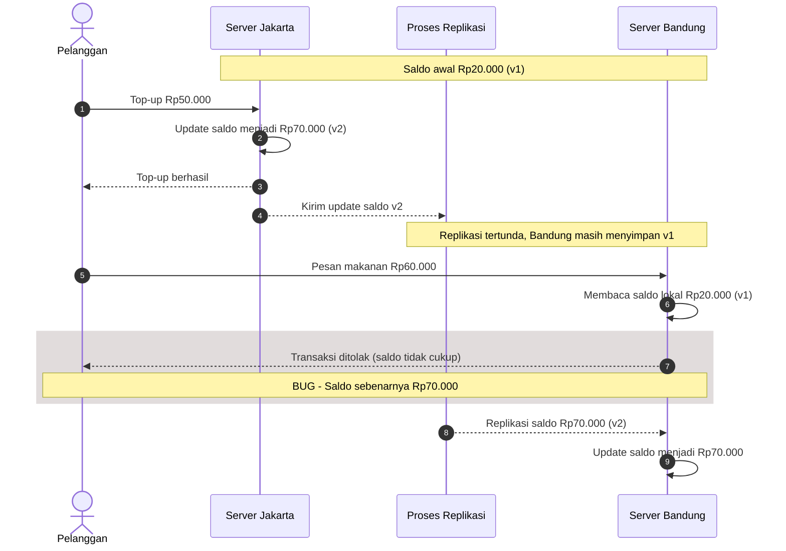
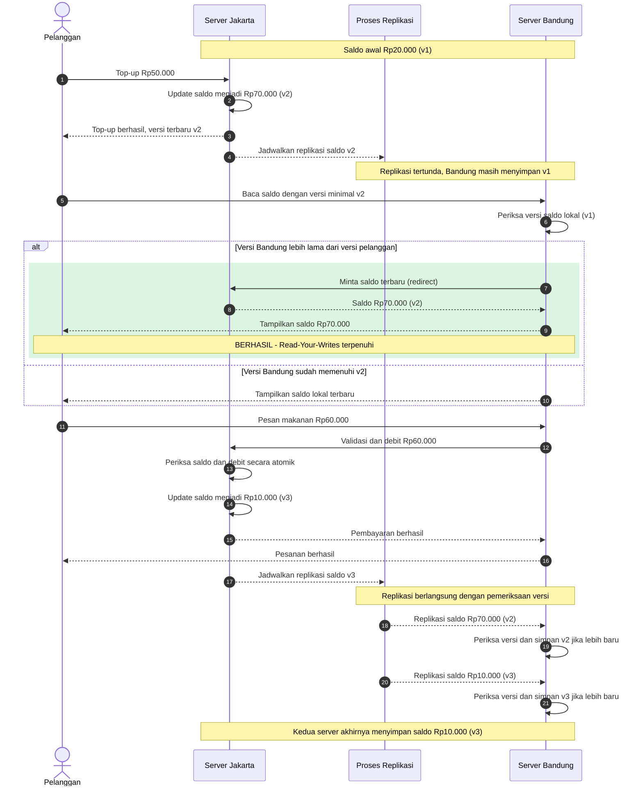

# Jurnal Proses — Tugas 7

## Diskusi pemilihan model konsistensi

- Argumen yang dipertimbangkan:

  Eventual Consistency cocok untuk data yang boleh tertinggal sementara, seperti jumlah like atau ulasan. Namun, model ini kurang tepat jika diterapkan pada kasus saldo e-wallet. Keterlambatan replikasi Jakarta-Bandung membuat pelanggan yang baru melakukan top-up tetap membaca saldo lama, sehingga pembayarannya ditolak meskipun saldo sebenarnya mencukupi.

  Karena berkaitan dengan uang, kejadian ini dapat merusak pengalaman dan kepercayaan pelanggan. Menurut kami, Eventual Consistency saja tidak cukup. Sequential Consistency diperlukan sebagai pendekatan yang lebih kuat untuk menjaga urutan operasi pada data saldo. Selain itu, masalah utama dalam studi kasus adalah pelanggan tidak melihat hasil top-up miliknya sendiri setelah berpindah ke server Bandung. Oleh karena itu, diperlukan Client-Centric Consistency berupa Read-Your-Writes.

  Batasannya, Read-Your-Writes tidak mencegah double-spending antarperangkat, sehingga pengurangan saldo tetap harus divalidasi pada satu sumber saldo yang otoritatif.

  Sequential consistency dipertimbangkan agar urutan operasi perubahan saldo secara konsisten. Namun, karena Sequential consistency tidak menjamin urutan berdasarkan waktu nyata, model ini saja belum cukup untuk memastikan pelanggan langsung melihat saldo setelah top up. Jad9 kami menerapkan read-your-writes sebagai jaminan khusus bagi pelanggan, serta menggunakan primary otoritatif dengan operasi debit atomik untuk menjaga keamanan transaksi keuangan.

- Kesimpulan akhir & alasan:

  Read-Your-Writes (Client-Centric Consistency) digunakan sebagai solusi utama untuk pelanggan yang berpindah dari server Jakarta ke Bandung. Server Bandung memeriksa versi terakhir yang dimiliki klien, lalu mengarahkan pembacaan ke Jakarta apabila replikanya belum sinkron.

  Untuk operasi keuangan, debit dan kredit diurutkan melalui satu primary per akun dengan pemeriksaan dan pengurangan saldo secara atomik. Dengan begitu, pembayaran tidak ditolak karena saldo usang dan risiko double-spending dapat dikurangi.
  
  Mekanisme read-your-writes diterapkan dengan memberikan nomor versi pada setiap pembaruan saldo. Setelah top up berhasil, server Jakarta mengembalikan nomor versi terbaru kepada pelanggan. Ketika pelanggan mengakses server Bandung, aplikasi membawa nomor versi tersebut sebagai versi minimal yang harus dipenuhi. Jika versi saldo Bandung lebih rendah, pembacaan dialihkan ke Jakarta. Dengan mekanisme ini, pelanggan tetap mendapatkan saldo terbaru meskipun proses replikasi belum selesai.

- Sequence Diagram
  Sequence diagram menggambarkan perbedaan alur untuk skenario saat bug terjadi dan skenario dengan solusi yang kelompok kami usulkan
  1. saat bug terjadi

2. skenario dengan solusi kelompok

## Simulasi (jika dikerjakan)

- Hasil skenario naif vs Read-Your-Writes:

  Pada skenario naif, pelanggan melakukan top-up sebesar Rp50.000 melalui server Jakarta. Namun, ketika pelanggan membaca saldo melalui Bandung setelah 0,5 detik, saldo yang ditampilkan masih Rp0 karena replikasi belum selesai. Hal ini menunjukkan terjadinya inconsistent read.

  Pada skenario Read-Your-Writes, pelanggan kembali melakukan top-up sebesar Rp20.000 sehingga saldo menjadi Rp70.000 dengan versi 2. Ketika pelanggan membaca saldo melalui Bandung, sistem mendeteksi bahwa versi Bandung masih tertinggal. Oleh karena itu, pembacaan dialihkan ke server Jakarta yang sudah memiliki data terbaru.

  Hasilnya, pelanggan langsung mendapatkan saldo Rp70.000 tanpa harus menunggu replikasi selesai. Setelah proses replikasi berlangsung, kedua server memiliki saldo yang sama, yaitu Rp70.000.

  table hasil pengujian simulasi:

| No. | Skenario Pengujian | Hasil yang Diharapkan | Hasil Aktual | Status |
|---|---|---|---|---|
| 1 | Top-up pertama Rp50.000 di Jakarta | Saldo Jakarta menjadi Rp50.000 (v1) | Rp50.000 (v1) | Berhasil |
| 2 | Membaca saldo Bandung setelah 0,5 detik tanpa Read-Your-Writes | Saldo lama Rp0 terbaca akibat replikasi tertunda | Rp0 | Bug terdeteksi |
| 3 | Replikasi pertama ke Bandung setelah 2 detik | Saldo Bandung menjadi Rp50.000 (v1) | Rp50.000 (v1) | Berhasil |
| 4 | Top-up kedua Rp20.000 di Jakarta | Saldo Jakarta menjadi Rp70.000 (v2) | Rp70.000 (v2) | Berhasil |
| 5 | Pemeriksaan versi saldo Bandung | Sistem mendeteksi versi Bandung masih v1 | Versi Bandung 1, membutuhkan versi 2 | Berhasil |
| 6 | Read-Your-Writes melalui redirect ke Jakarta | Saldo terbaru Rp70.000 dapat dibaca | Rp70.000 | Berhasil |
| 7 | Replikasi kedua selesai | Saldo Jakarta dan Bandung sama-sama Rp70.000 | Jakarta Rp70.000, Bandung Rp70.000 | Berhasil |
## Log Penggunaan AI (Level 2)

| Tanggal | Tool AI | Prompt yang diberikan | Ringkasan saran/ide AI | Bagaimana diolah jadi tulisan/kode sendiri |
|---|---|---|---|---|
| 15 November 2026 | ChatGPT | Membantu memahami perbedaan Sequential Consistency, Eventual Consistency, dan Read-Your-Writes pada studi kasus saldo FoodGo. | Memberikan penjelasan mengenai dampak keterlambatan replikasi terhadap transaksi saldo serta pendekatan konsistensi yang relevan. | Digunakan sebagai bahan diskusi untuk memahami konsep dan menentukan pendekatan konsistensi yang sesuai dengan studi kasus. |
| 15 November 2026 | ChatGPT | Membantu memahami dan memperbaiki TODO pada simulasi `replica_simulation.py`. | Memberikan penjelasan mengenai penggunaan `threading.Timer()`, pemeriksaan versi replika, dan mekanisme redirect ke Jakarta. | Saran digunakan sebagai referensi untuk mempelajari implementasi, kemudian kode disesuaikan dengan skeleton tugas dan diuji secara mandiri. |
